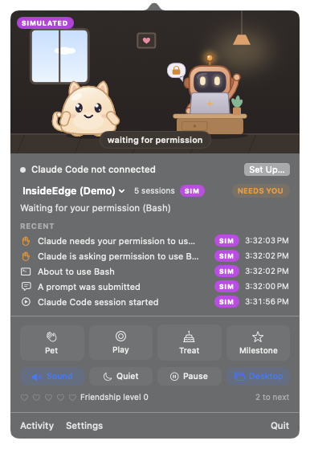
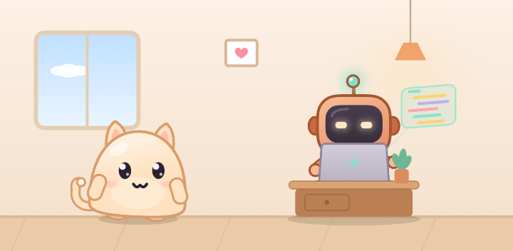

# MacTamagotchi — Claude Companion Edition

A tiny animated world in your Mac's menu bar. **Mochi**, your pet, lives there all the time.
When a Claude Code session starts, the **Claude Code mascot** — in pixel art, with Claude's own spinner
over its head — hops onto its desk beside a little laptop and reacts to what Claude Code *actually*
reports: reading, searching, editing, running commands, waiting for you, tool errors, and finished
turns. The two of them bring each other coffee, play rock-paper-scissors, celebrate together, chat in
speech bubbles, and nap while the other keeps watch.

- Native macOS app (Swift 6, SwiftUI + AppKit), lives in the menu bar, no Dock icon.
- Real Claude Code integration through documented **hooks** — no terminal scraping, no screen
  reading, no input injection, no private APIs.
- Local-first: a private Unix socket, no network port, no server, no account.
- Honest: a successful tool call is not a finished turn, and a finished turn is not a passing build.
- Useful without Claude Code: pet, play, treats, friendship, achievements.

<p align="center"> </p>

## Quick start

Requirements: macOS 14 or later, Xcode 16+ (tested with Xcode 27 / Swift 6.4 on macOS 27).

```bash
scripts/build-app.sh --install        # builds build/MacTamagotchi.app and copies it to ~/Applications
open ~/Applications/MacTamagotchi.app
```

Then click the pet in the menu bar › **Set Up…** (or Settings › Claude Code) › **Connect Claude Code…**.
MacTamagotchi shows you exactly what it will add, backs up `~/.claude/settings.json`, merges one hook
entry per event, and verifies the connection. Start a new Claude Code session and Patch will join.

Disconnect any time from the same place; only MacTamagotchi's entries are removed (after another backup).

## Features

| | |
|---|---|
| **Menu bar** | Mochi lives on the menu bar in full colour: it breathes, blinks, glances and flicks its ears and tail, and roams the whole bar right of the notch — wandering, sniffing, zoomies, ball/yarn games, butterfly chases, naps — then trots home to its bed at the status item. During Claude Code sessions mini Patch sits at home; Mochi joins it, waves when Claude needs you and celebrates finished turns. A transparent click-through overlay keeps your other menu-bar items clickable and stays below menus; it hides for full-screen apps and falls back gracefully. Styles: *Roams the menu bar* (default), *Plays in its spot*, *Classic icon*. Adaptive frame rate (≈1–2 % CPU calm, ≈3–4 % while roaming). |
| **Your Mac's rhythm** | Mochi sleeps while your Mac rests (no typing or clicking for a few minutes, displays asleep, or another user switched in) and wakes with a stretch when you're back, so it's awake while you work. A video or call keeping the screen on, Claude at work, or a busy processor keeps it up. Only the time since your last input is read, never what you type. With the iPhone app, Mochi naps in its room on the phone too. Settings › Mochi › Naps. |
| **Popover** | The living scene, connection status, session selector (multiple sessions are never mixed), status line, result card, recent events (SIM/LATE tags), pet controls, sound/quiet/pause/desktop toggles, friendship hearts. |
| **Two characters** | 38 pet animation states with follow-through (ears and tail lag, squash on landings, dust), a living idle, multi-variant play (ball chase, yarn tangle, butterfly, bubbles), treats (cookie catch, berry, cupcake) and petting (melt-and-purr, roll-over, chin scratch); 33 companion states, procedural vector art, accessories, 7 coat colours, 4 office themes (cozy desk, cyberpunk, space station, garden office). |
| **Interactions** | 16 coordinated scripts: coffee delivery, show-and-tell, ball distraction, rock-paper-scissors, keeping watch, rare chair thief / keyboard nap / mysterious glow, welcome, high five, victory dance, tiny trophy, detective mode, case closed, graduation, synchronized dance. Weighted, seeded scheduler with cooldowns, daily caps and anti-repeat. |
| **Claude Code** | 13 hook events (feature-detected per installed version), guided consent-first installer with preview, backups, merge, verification and clean removal; sessions tracked independently with a documented primary-session rule. |
| **Celebrations** | High five for a finished turn, victory dance for long turns (only when both ends were observed live), trophy for real build/test results, detective mode after repeated tool errors and “case closed” when the turn then finishes, graduation for milestones. |
| **Desktop pet** | Optional transparent, frameless, non-activating window: drag to move, click to pet, right-click menu, always-on-top option, sizes, click-through mode, per-display position memory, ⌃⌥⌘P to show/hide. Patch appears only for interesting moments. |
| **Notifications** | Per-category animate / badge / banner / sound, quiet hours and quiet mode, banner batching, nothing for simulated or late events. |
| **Progress** | Transparent local achievements and friendship levels with daily caps. Nothing ever decreases; the pet never gets sick or sad. |
| **Mochi grows up** | Kitten (small, big eyes, a tuft of fur) → young → grown-up (a little bell collar) over weeks of friendship; never reverses. |
| **Mochi talks** | Speech bubbles for greetings, real Claude events ("Claude's done, high five!"), petting and sleepy mumbles — over the scene, or just under the menu bar when the panel is closed. Chattiness quiet/normal/chatty; optional fresh lines written by Apple Intelligence on this Mac. |
| **Ask Mochi** | Press ⌥Space and type, or hold it and talk: "pause the music", "open Slack", "play lo-fi beats on YouTube", "tell the Tamagotchi Claude to make the animations smoother". Quick things happen instantly on the Mac; the rest goes to a helper Claude session (your Claude Code login) that can open apps and links, bring windows forward, press music keys, run your Shortcuts and message your other Claude sessions. Each message is shown on a card first and sent only when you press Send. It arrives as "Message from @mochi" through Claude Code's own session messaging, never typed into a window, and Mochi tells you when that session finishes. |
| **Mochi's agent** | Turn it on in Settings › Agent and Mochi keeps an eye on Gmail, Google Calendar and Notion through the connectors in your own Claude account (Connect… opens claude.ai, where you pick the account). Every few minutes a short Claude Haiku run on your subscription reads what's new with read-only tools, and Mochi tells you what matters ("2 new emails · Figma: someone mentioned you (needs a reply)") in a speech bubble, with a menu-bar badge and, if you like, on your iPhone. A morning briefing sums up the day, and ⌥Space "what's pending?" asks any time. Quiet hours, newsletters kept off the phone, VIPs, ✓ done that syncs with Mochi Pocket (and, if you like, marks the email read), meeting heads-ups with Join, reply drafts in Gmail Drafts from Mochi Cloud. Nothing is ever sent or deleted. |
| **Feel the purr** | Press and hold on Mochi (panel or desktop pet): it keeps purring and a Force Touch trackpad purrs along. |
| **Explore the desktop** | Drag Mochi off the menu bar (or click Explore): it walks along your window tops, sits on the Dock, climbs a screen edge and hops back home. Spontaneous adventures now and then if you like. Only window positions are read. |
| **The notch is Mochi's den** | On MacBooks, Mochi sometimes naps inside the notch, peeks out when Claude needs you and bursts out to celebrate. |
| **Mini-games** | Catch the Treats (arrow keys or drag; combos, golden treats, high score) and rock-paper-scissors with Mochi and the mascot (scores against each). |
| **Focus buddy** | A Pomodoro timer: Mochi naps while you focus (non-urgent sounds stay quiet) and wakes you for a stretch break; progress row in the panel. |
| **Daily recap** | At 18:00 a card with the day's real numbers — sessions, turns finished, tool calls, test runs, errors bounced back, focus minutes, streak. Save or copy it as an image. |
| **Share a clip** | One click records a 5-second looping GIF of the scene (drawn by the app, never a screen capture) to Downloads. |
| **Holidays** | Halloween, Diwali, Christmas, New Year, Valentine's Day and birthdays decorate the room and the menu bar, put costumes on both characters and turn treats seasonal. |
| **Room makeover** | Twelve pieces of furniture unlocked by friendship and achievements; click Decorate and drag them into the room. |
| **On your iPhone** | Mochi Pocket, an iPhone companion (testing build), shows Mochi and Patch as a Live Activity on the Lock Screen and in the Dynamic Island while Claude works. It lights up when Claude needs you and celebrates when Claude is done. Its expanded and Lock Screen views move from pose to pose with each update, since Live Activities can't run animations of their own. The app has Mochi's own room, drawn by the same code as the Mac panel, with Patch at the desk working whenever Claude works on your Mac. Pet, play and treats show on both devices. Press and hold Mochi to talk: it turns its right ear and shoulder towards you and listens, and the request runs on your Mac through Ask Mochi, with the answer and any approval back on the phone. Optionally, when a Claude session finishes, your iPhone gets a short summary of what it did and the files it changed, and you can reply to that session from the notification. The Mac drives the Live Activity through Apple's push service, and the two find each other through your iCloud. See [docs/LIVE_ACTIVITY.md](docs/LIVE_ACTIVITY.md). |
| **Desktop widget** | A small and medium "Mochi & Claude" widget for the desktop or Notification Center. |
| **Privacy** | Hook payloads are reduced to an allow-list inside the hook process. Prompts, tool input, command output and file contents never leave Claude Code; Claude's closing messages only when you share summaries with your iPhone. Ask Mochi sends only what you ask (plus app and session names) and listens only while you hold the shortcut. |

## How it works

```
Claude Code ──hook──▶ mactamagotchi-hook ──Unix socket (0600, peer-UID checked)──▶ MacTamagotchi
   (stdin JSON)        sanitize · ~4 ms · exit 0           │                          validate → normalize → dedupe
                       spool if the app isn't running ─────┘                          → sessions → journal → mapper
                                                                                       → animations / notifications
```

- [docs/SETUP.md](docs/SETUP.md) — install, connect, explicit build/test reports, isolated runs, uninstall
- [docs/CLAUDE_CODE_INTEGRATION.md](docs/CLAUDE_CODE_INTEGRATION.md) — hooks, payload handling, event → state → animation mapping
- [docs/ARCHITECTURE.md](docs/ARCHITECTURE.md) — modules, state machines, scheduling, rendering, performance
- [docs/PRIVACY.md](docs/PRIVACY.md) — exactly what is received and what is kept
- [docs/TROUBLESHOOTING.md](docs/TROUBLESHOOTING.md)
- [docs/TESTING.md](docs/TESTING.md) — automated tests, end-to-end script, scenario results, manual checks
- [docs/CHARACTERS.md](docs/CHARACTERS.md) — character bible and asset specification
- [docs/LIVE_ACTIVITY.md](docs/LIVE_ACTIVITY.md) — investigation of an iPhone Live Activity companion

## Development

```bash
swift build                      # debug build of everything
swift test                       # 348 unit and integration tests (Swift Testing)
scripts/build-app.sh             # release .app bundle (ad-hoc signed; set SIGN_IDENTITY to sign properly)
scripts/e2e.sh                   # end-to-end checks against an isolated instance
scripts/e2e.sh --with-claude     # …plus a short real `claude -p` session through the hooks
.build/debug/MacTamagotchi --render-snapshots /tmp/snaps   # render every pose, scene and glyph to PNG
.build/debug/MacTamagotchi --render-strips /tmp/strips      # motion strips for every animation and variant
.build/debug/MacTamagotchi --render-menubar /tmp/menubar    # the menu-bar pet over time, light and dark
```

Run a fully isolated instance (own data directory, socket and hooks — handy for development):

```bash
MACTAMAGOTCHI_HOME=/tmp/mtg-dev build/MacTamagotchi.app/Contents/MacOS/MacTamagotchi
```

The **Developer** tab in Settings has an event simulator (clearly marked SIM; never stored, never
counted, never notified), single-event buttons and an animation/interaction previewer.

## Project layout

```
Sources/
  TamagotchiWire/   wire format, payload sanitizer, command classifier, socket client, spool (shared with the helper)
  HookHelper/       mactamagotchi-hook — the command Claude Code hooks run
  TamagotchiCore/   events, validation, sessions, animation state machines, poses, interactions, scheduler,
                    mapper, journal, settings, notification policy, achievements, hook installer, bridge, world
  App/              menu bar, popover, renderers, desktop pet, windows, sound, notifications, debug tools
Tests/TamagotchiCoreTests/
scripts/            build-app.sh, e2e.sh
docs/
```

## Known limitations

See [docs/TESTING.md](docs/TESTING.md#known-limitations-and-manual-verification) for the full list. Highlights:
`Notification` (idle/permission prompts in interactive sessions), `SubagentStart/Stop` and `StopFailure` were
exercised with real-format payloads and the simulator, but not produced by a live interactive Claude Code session
during development; notarization requires your own Developer ID; Live Activities come from the iPhone companion (Mac apps can't start them).
